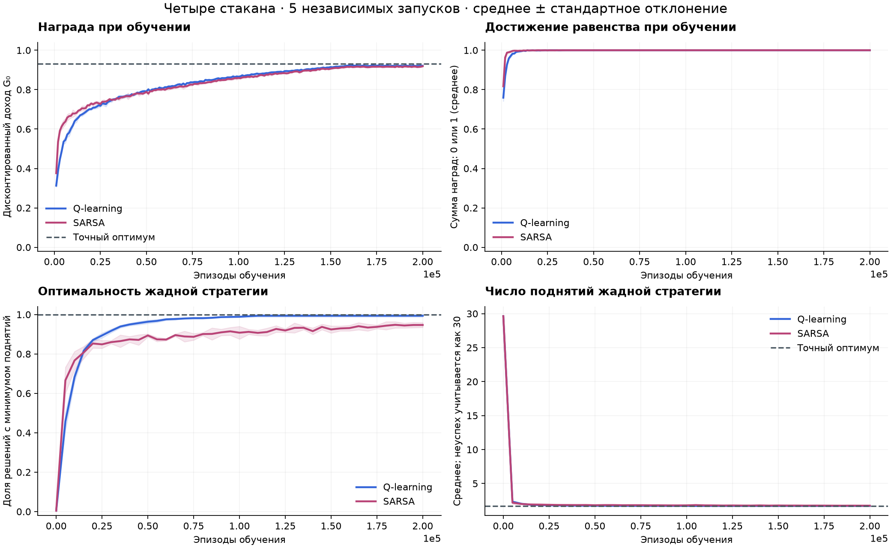

# Четыре стакана: обучение с подкреплением

Практическое задание №4 по дисциплине «Интеллектуальные системы и технологии».
Агент уравнивает компот в четырёх стаканах за минимальное число поднятий.
Одно поднятие позволяет перелить компот сразу в несколько стаканов.

**Реализованы Q-learning и SARSA; отрицательных наград нет.**

**[Открыть JupyterLite и ноутбук](https://arr4nkar.github.io/kompot-rl/lab/index.html?path=kompot.ipynb)**
· [Прочитать выполненный ноутбук без запуска](https://arr4nkar.github.io/kompot-rl/report.html)

## Что открыть

- [`content/kompot.ipynb`](content/kompot.ipynb) — основной ноутбук: математическая модель, алгоритмы, обучение, кривые и демонстрация.
- [`REPORT.md`](REPORT.md) — отчёт о постановке эксперимента и результатах.
- [`content/kompot_rl.py`](content/kompot_rl.py) — среда и оба алгоритма.
- [`content/experiment.py`](content/experiment.py) — повторные эксперименты и построение графиков.
- [`results/summary.csv`](results/summary.csv), [`results/checkpoints.csv`](results/checkpoints.csv) — измеренные результаты.

В ноутбуке уже сохранены результаты полного эксперимента. Для повторного запуска
выберите **Run → Run All Cells**. По умолчанию `MODE = "full"` повторяет
основной эксперимент с пятью seed; `"quick"` уменьшает бюджет, `"saved"` читает готовые результаты.

## Математическая модель

### Состояния

Состояние — четыре целых числа `s = (v₀, v₁, v₂, v₃)`:
`0 ≤ vᵢ ≤ 6`, `v₀ + v₁ + v₂ + v₃ = 12`.
Четыре переменные описывают объёмы; независимы три, поскольку общий объём постоянен.
Стаканы различимы: перестановки объёмов являются разными состояниями.

Число состояний — коэффициент при `x¹²` в `(1+x+...+x⁶)⁴`:

`|S| = C(15,3) − 4·C(8,3) = 455 − 224 = 231`.

Из них 230 начальных нетерминальных и одно целевое `(3,3,3,3)`.

Вместимость 6 и общий объём 12 — **принятые допущения**, а не числа из задания.
Можно считать одну единицу равной 50 мл: стаканы по 300 мл, всего 600 мл.
Дискретизация делает точное равенство достижимым и позволяет считать состояния.
Для вещественных объёмов состояний было бы бесконечно много.

### Вознаграждение

Промежуточное поднятие приносит `0`; действие, впервые приводящее к равенству, — `+1`.
Не требуется заранее решать, какой промежуточный ход «правильный».

`r(s,a,s′) = 1`, если `s′ = (3,3,3,3)`, иначе `0`.

Цель агента — максимизировать **дисконтированный доход**:
`G₀ = Σ γᵗ rₜ₊₁`, где `γ = 0.9`.
При успехе за `L` поднятий `G₀ = γ^(L−1)`: за одно поднятие — 1,
за два — 0.9, за три — 0.81. Чем меньше поднятий, тем выше доход.
Просто сумма недисконтированных наград равна 1 при любом успехе и сама по себе
не задаёт требование минимального числа поднятий.

### Завершение эпизода

Успешный эпизод заканчивается при равенстве четырёх объёмов.
Ограничение в 30 поднятий прерывает неудачную попытку; это `truncated`, а не достижение цели.
После настоящего окончания bootstrap равен нулю. При техническом прерывании
bootstrap сохраняется: среда сама по себе не имеет горизонта 30, это ограничение сборщика опыта.
Счётчик шагов поэтому не входит в марковское состояние.

### Ограничения действий

**Штрафов и отрицательных наград нет**, в том числе за превышение лимита.
Физически невозможные действия исключены маской: агент не может перелить
больше имеющегося компота или переполнить стакан.
Маска не подсказывает правильное решение: допустимы в том числе бесполезные
переливания и циклы, увеличивающие неравенство.

### Действия и их кодирование

Действие — **одно полное поднятие**: выбрать источник `i` и три целых объёма
`(q₁,q₂,q₃)`, переливаемых в остальные стаканы по возрастанию их номеров.
Допускается перелить меньше всего содержимого и налить нескольким получателям.

При вместимости 6 кодирование такое:

`k = 49q₁ + 7q₂ + q₃`, `a = 342i + k − 1`.

Источник `i ∈ {0,1,2,3}`, `qⱼ ∈ {0,...,6}`, `k ≠ 0`.
Глобально есть **1368 кодов**, от `0` до `1367`. В каждом нетерминальном
состоянии физически допустимы **54–86** действий. Всего в модели 17 816
допустимых пар «состояние–действие». Целевое состояние действий не имеет.

Пример: `(6,2,2,2)`, источник `i=0`, объёмы `(1,1,1)` → действие `a=56`
→ `(3,3,3,3)`, одно поднятие и награда `+1`.
Стакан в руке не нужен в состоянии: весь акт поднятия и разлива — один шаг.

## Как сравниваются методы

Общие параметры: `α=0.5`, `γ=0.9`, ε линейно уменьшается с 0.6 до 0.05
за первые 80% обучения и затем постоянна. Параметры выбраны после пробных
прогонов; раздельной оптимизации параметров под каждый метод не проводилось.
Нулевые Q-таблицы; случайный выбор среди равных оценок при обучении.

Основной опыт: 200 000 эпизодов, пять seed `(0,1,2,3,4)` на метод.
Начальные состояния равномерно выбираются из 230 вариантов. У парных запусков
с одинаковым seed одинаковая последовательность начальных состояний;
генератор разведки отделён от генератора стартов.

Каждые 5000 эпизодов жадная стратегия (`ε=0`) проверяется на **всех 230**
нетерминальных состояниях. При равенстве Q на проверке выбирается первый
допустимый код; случайность проверки не маскирует неуспех.
Это оценка освоения **известной конечной среды**, не тест обобщения на новые объёмы.
Награда при обучении и оценка жадной стратегии показаны раздельно.
Полосы на графиках — стандартное отклонение пяти запусков, не доверительный интервал.

Минимум найден независимым BFS по всем переходам, без использования Q-таблиц.
Этот поиск не участвует в обучении или выборе действий.
Есть и аналитическое доказательство: минимум равен числу стаканов с объёмом
выше среднего. Каждый такой стакан необходимо поднять; последовательно
разливая только его избыток по недостающим объёмам, достаточно поднять каждый
из них один раз. При наших параметрах оптимум — от одного до трёх поднятий.

| Метод | Успех | Оптимальные решения | Среднее число поднятий |
|---|---:|---:|---:|
| Q-learning | 100% | 99.39% ± 0.58 п.п. | 1.693 ± 0.006 |
| SARSA | 100% | 94.70% ± 1.21 п.п. | 1.741 ± 0.013 |
| Точный оптимум | 100% | 100% | 1.687 |

Среднее ± выборочное стандартное отклонение по seed.
В данном эксперименте Q-learning лучше по итоговой оптимальности и доходу;
утверждение не переносится автоматически на другие задачи и настройки.
Предопределённый демонстрационный запуск Q-learning с `seed=0` достиг
минимума во всех 230 состояниях; таблица выше учитывает все пять запусков.



## Запуск на компьютере

Требуется Python 3.11 или 3.12. Из корня проекта:

```bash
python -m venv .venv
# Windows: .venv\Scripts\activate
# Linux/macOS: source .venv/bin/activate
python -m pip install -r requirements.txt -r requirements-lite.txt
python -m unittest discover -s tests -v
python content/experiment.py --episodes 200000 --seeds 5 --output results
python scripts/build_notebook.py
python scripts/build_site.py
python -m http.server 8000 --directory _output
```

Откройте `http://localhost:8000/lab/index.html?path=kompot.ipynb`.
Само обучение выполняется в браузере: Python-сервер нужен лишь для выдачи
статических файлов. При первом запуске ядро и библиотеки загружаются из сети.
Для обычного Jupyter установите `jupyterlab` и запустите `jupyter lab content/kompot.ipynb`.

## GitHub Pages

Workflow [`.github/workflows/pages.yml`](.github/workflows/pages.yml) запускает тесты,
собирает JupyterLite и публикует его через GitHub Pages.
В настройках репозитория выберите **Settings → Pages → Source → GitHub Actions**.
Публикация идёт при push в `main`, а также вручную из Actions; pull request
только проверяется и собирается. В `lab/index.html?path=kompot.ipynb` открывается ноутбук.
Собранный сайт также сохраняется как артефакт workflow.

Исходные лекционные файлы в репозиторий не включены. Материалы курса:
«ИСиТ пр.pptx», задание №4; «ИСиТ RL small.pdf», разделы MDP, SARSA и Q-обучение.

Технические источники:
[JupyterLite / GitHub Pages](https://jupyterlite.readthedocs.io/en/stable/quickstart/deploy.html),
[добавление файлов](https://jupyterlite.readthedocs.io/en/stable/howto/content/files.html),
[Sutton & Barto, Reinforcement Learning](http://incompleteideas.net/book/the-book-2nd.html).
