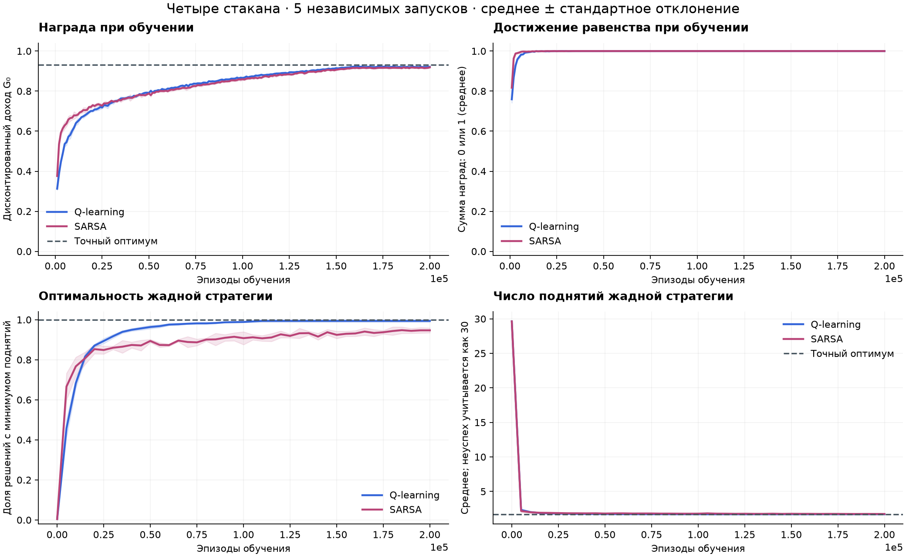

# Результаты практической работы №4

## Задача и модель

Агент должен уравнять компот в четырёх стаканах за минимальное число поднятий.
За одно поднятие можно разлить компот в несколько получателей.
Выбрана целочисленная модель: вместимость каждого стакана 6, всего компота 12,
цель `(3,3,3,3)`. Эти параметры являются допущением, поскольку в условии их нет.

231 состояние, 230 нетерминальных стартов, 1368 глобальных кодов действий,
17 816 физически допустимых пар «состояние–действие».
Одно действие включает источник и три объёма переливания.

Награда: 1 при достижении равенства, 0 иначе. **Отрицательных наград нет**.
Дисконтированный доход `G₀ = 0.9^(L−1)` предпочитает короткие успешные решения.
Неуспешная попытка прерывается после 30 поднятий без дополнительного штрафа.

## Протокол

- Два табличных метода: Q-learning и SARSA.
- Общие параметры: α=0.5, γ=0.9, ε от 0.6 до 0.05 за первые 80% обучения.
- 200 000 эпизодов на запуск; seed 0, 1, 2, 3, 4.
- Нулевые Q-таблицы; парные последовательности стартов одинаковы.
- Каждые 5000 эпизодов: жадная стратегия на всех 230 стартах.
- При проверке нет разведки; равные Q разрешаются первым допустимым кодом.
- Неуспешные случаи не исключаются: учитываются как 30 поднятий.
- BFS даёт точный минимум и не участвует в обучении.

Гиперпараметры выбраны после пробных прогонов; раздельной оптимизации под
каждый метод не проводилось. Проверочные состояния встречались при обучении:
эксперимент оценивает освоение данной среды, а не обобщение на невиденные задачи.

## Измеренные результаты

| Метод | Успех | Оптимальные решения | Поднятия | Доход | AUC дохода |
|---|---:|---:|---:|---:|---:|
| Q-learning | 100.0% | 99.39% ± 0.58 п.п. | 1.6930 ± 0.0058 | 0.9309 | 0.9152 |
| SARSA | 100.0% | 94.70% ± 1.21 п.п. | 1.7409 ± 0.0129 | 0.9266 | 0.9096 |
| Случайный выбор | 12.0% | 0.83% | 28.2639 | 0.0392 | — |
| Точный оптимум | 100% | 100% | 1.6870 | 0.9315 | — |

Среднее ± выборочное стандартное отклонение по пяти seed. Доля оптимальных
решений приведена в процентах, её отклонение — в процентных пунктах.
AUC — площадь под кривой проверочного дохода, делённая на бюджет обучения;
вычислена трапециями по checkpoint, включая нулевой. Случайный выбор оценён
на десяти повторах всех стартов, генератор seed=999.

Верхние кривые — средние по блокам по 1000 эпизодов с разведкой. Нижние —
жадные стратегии без разведки. Полосы — ± одно стандартное отклонение, а не
доверительные интервалы. Рост успеха сам по себе ещё не означает оптимальности:
требуется проверять именно число поднятий.

## Вывод

При данных общих настройках Q-learning лучше по итоговому доходу, доле
оптимальных решений и AUC проверочного дохода. В начале части опытов SARSA
обучается быстрее, но его итоговая жадная стратегия чаще делает лишнее поднятие.
Возможное объяснение — SARSA обновляет оценку с учётом следующего разведочного
действия, а ε остаётся положительной. Это интерпретация наблюдения, а не
доказательство универсального превосходства одного алгоритма.

Предопределённый демонстрационный запуск Q-learning с seed=0 достиг минимума
во всех 230 стартах. Остальные запуски также включены в сравнение: полного
достижения оптимума во всех запусках не заявляется. Постоянные α и ε не дают
основания ссылаться на теорему асимптотической сходимости как на доказательство
оптимальности конкретного конечного опыта.

## Почему минимум проверен точно

Каждый стакан с объёмом выше среднего обязательно нужно поднять, чтобы
уменьшить его объём. Одного поднятия каждого такого стакана достаточно:
его избыток можно разлить по стаканам с дефицитом. Поэтому точный минимум
равен числу стаканов с объёмом выше 3. Независимый BFS подтверждает эту
формулу на всех 231 состояниях. Из 230 стартов 76 требуют одно поднятие,
150 — два, 4 — три. Среднее: `(76 + 2·150 + 3·4)/230 = 1.6869565`.

## Воспроизводимость и границы

Команда: `python content/experiment.py --episodes 200000 --seeds 5 --output results`.
Подробности всех checkpoint: `results/checkpoints.csv`. Конфигурация, кривые,
seed, время и демонстрационные стратегии: `results/results.json`.
Полное описание модели и инструкции запуска приведены в README.

Дискретизация, общая сумма, одинаковая вместимость и отсутствие потерь —
ограничения модели. Результаты не доказывают качество на других параметрах.
Локальное время включает периодическую проверку; в браузере скорость может отличаться.

Источники: «ИСиТ пр.pptx», задание №4; «ИСиТ RL small.pdf», разделы MDP,
SARSA и Q-обучение. Исходные лекционные файлы в проект не включены.
